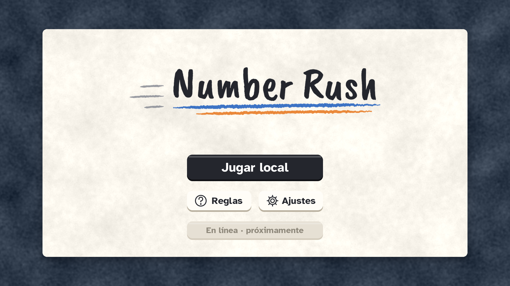

### No tan serios. Muy buenos momentos. 🎮

**Estudio independiente de videojuegos · Estado de México**

*Indie games made in Mexico, for players everywhere.*

---

## Somos Ni Tan Tan Studios

Creamos videojuegos para desafiarte, sorprenderte y conectar con otros jugadores. Somos un estudio independiente nacido en el Estado de México, con ganas de llevar experiencias originales a jugadores de todo el mundo.

## 🎮 Nuestros juegos

### ⚡ Number Rush

**Piensa rápido. Juega más rápido.**

Un juego móvil de números, velocidad y competencia. Pon a prueba tus reflejos y tu estrategia, juega en solitario o enfréntate a otros jugadores.

**Plataforma:** Android · **Motor:** Godot · **Estado:** En desarrollo

### 📬 Última Recolección

**Algunas historias merecen ser entregadas.**

Una experiencia narrativa ambientada en una oficina de correos. Un proyecto centrado en la atmósfera, los personajes y las historias que quedan por contar.

**Motor:** Godot 4 · **Estado:** En desarrollo

---

## ✨ Lo que nos mueve

**Creatividad sin límites.** Exploramos ideas y buscamos darles una identidad propia.

**Diversión con identidad.** Nos interesan los juegos memorables, no solo las mecánicas.

**De México para el mundo.** Nuestras raíces son mexicanas y nuestra visión es internacional.

---

## 🌎 About Us

**Not too serious. Seriously fun.**

Ni Tan Tan Studios is an independent game development studio based in the State of Mexico. We create original games that challenge, surprise, and connect players around the world.

Our projects include **Number Rush**, a fast-paced mobile number game, and **Última Recolección**, a narrative experience built with Godot 4.

**Made in Mexico. Created for players everywhere.**

---

## 📬 Contacto / Contact

**Email:** [hola@alfredojones.dev](mailto:hola@alfredojones.dev) · **Web:** [alfredojones.dev](https://alfredojones.dev)

*Ni Tan Tan Studios — Independientes por naturaleza. Creativos por elección.*

