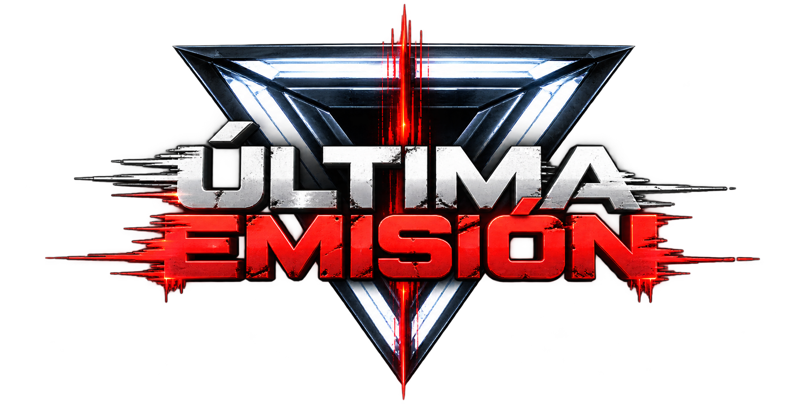
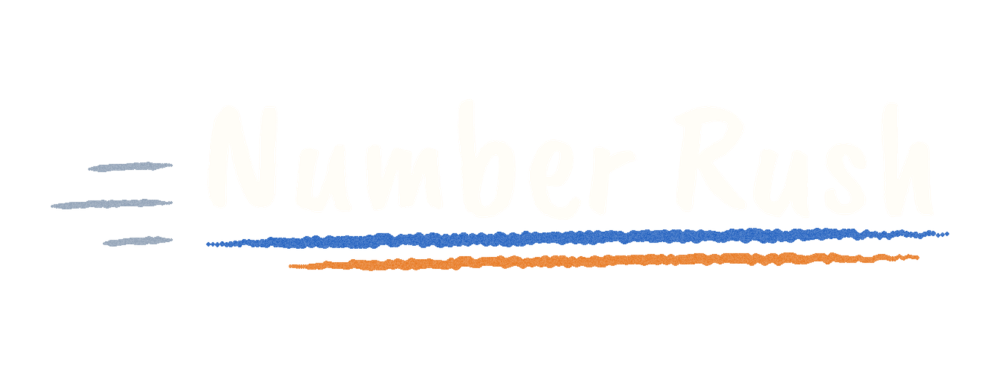
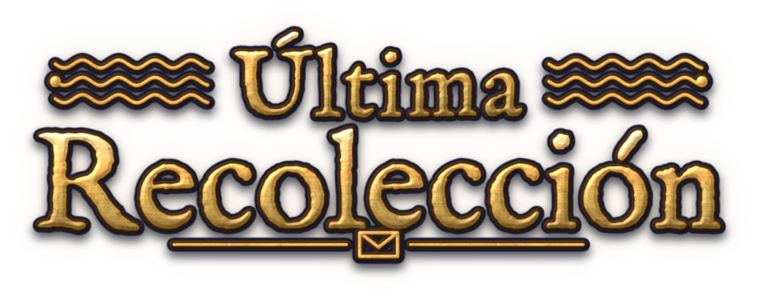

### No tan serios. Muy buenos momentos. 🎮

**Estudio independiente de videojuegos · Estado de México**

*Indie games made in Mexico, for players everywhere.*

---

## 🎮 Somos Ni Tan Tan Studios

Somos un estudio independiente de desarrollo de videojuegos nacido en el Estado de México.

Creamos experiencias interactivas originales que buscan desafiar, sorprender y conectar a jugadores de todo el mundo.

Nos apasiona experimentar con nuevas ideas, explorar diferentes géneros y construir juegos con identidad propia.

---

## 🕹️ Nuestros juegos

### ÚLTIMA EMISIÓN

  

**El espectáculo termina. Solo uno sale con vida.**

Un *party game* competitivo en 3D ambientado en un concurso televisivo distópico. Entre **4 y 8 concursantes** compiten en una sucesión impredecible de minijuegos mientras el público disfruta del espectáculo.

Las puntuaciones acumuladas permanecen ocultas y nadie sabe cuándo terminará la emisión. Al final, **solo un concursante gana la fortuna y sobrevive**.

Estamos diseñando una experiencia de partidas sociales, rivalidades, alianzas temporales y finales llenos de tensión, con modos **local, online y mixto**.

**PC · Steam (objetivo) · Unreal Engine 5 · En preproducción**

---

### Number Rush

**Piensa rápido. Juega más rápido.**

Un juego móvil de números, velocidad y competencia.

Pon a prueba tus reflejos y tu estrategia, disfruta desafíos individuales y enfréntate a otros jugadores.

**Android · Godot · En desarrollo**

---

### Última Recolección

**Algunas historias merecen ser entregadas.**

Una experiencia narrativa ambientada en una oficina de correos, donde las historias, los personajes y la atmósfera son protagonistas.

Un proyecto que explora nuestro lado más narrativo y creativo.

**Godot 4 · En desarrollo**

---

## ✨ Nuestra filosofía

**🎨 Creatividad sin límites**

Creemos que cada idea tiene el potencial de convertirse en una experiencia extraordinaria.

**🎮 Diversión con identidad**

No queremos hacer juegos que simplemente se jueguen. Queremos crear experiencias que se recuerden.

**🌎 De México para el mundo**

Nuestras raíces están en México, pero nuestra visión no tiene fronteras.

---

## 🌎 About Us

### Not too serious. Seriously fun.

**Ni Tan Tan Studios** is an independent game development studio based in the State of Mexico.

We create original gaming experiences designed to challenge, surprise, and connect players around the world.

Our passion is to explore new ideas, experiment with different genres, and build games with their own unique identity.

### Our Games

**📺 ÚLTIMA EMISIÓN**

A dystopian 3D multiplayer party game where 4–8 contestants compete in unpredictable minigames. Scores stay hidden, the show's length is a mystery, and only one contestant survives the finale.

*PC · Steam (planned) · Unreal Engine 5 · Pre-production*

**⚡ Number Rush**

A fast-paced mobile game focused on numbers, speed, and competition.

*Android · Godot · In development*

**📬 Última Recolección**

A narrative-driven game set in a post office, exploring stories, characters, and atmosphere.

*Godot 4 · In development*

**Made in Mexico. Created for players everywhere.**

---

## 📬 Contacto / Contact

**Correo / Email:** [hola@alfredojones.dev](mailto:hola@alfredojones.dev)

**Sitio web / Website:** [alfredojones.dev](https://alfredojones.dev)

**GitHub:** [Ni-Tan-Tan-Studios](https://github.com/Ni-Tan-Tan-Studios)

---

**NI TAN TAN STUDIOS**

*Independientes por naturaleza. Creativos por elección.*

🇲🇽 Made in Mexico

